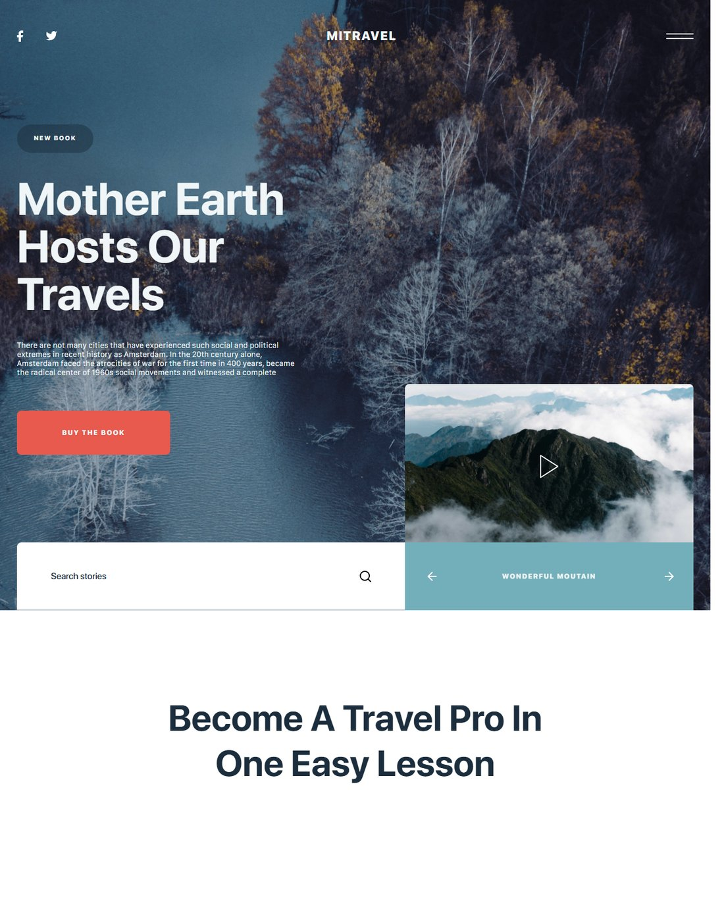
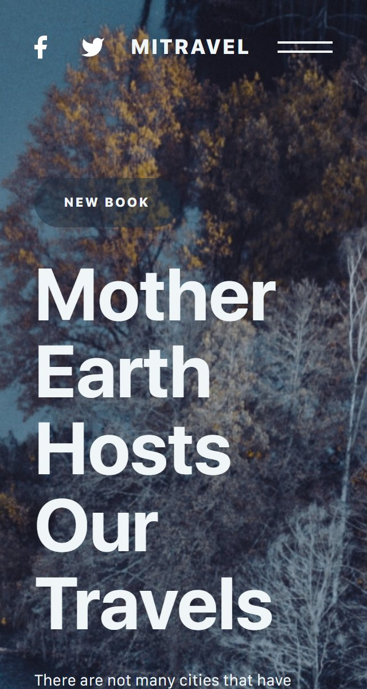

# Mitravel — лендинг о путешествиях

Адаптивный лендинг о путешествиях с полноэкранным hero-блоком, видеоплеером, слайдерами и формой подписки.

**Демо:** [pavelreb.github.io/Mitravel](https://pavelreb.github.io/Mitravel/)

| Десктоп | Мобильная версия |
|---|---|
|  |  |

## Возможности

- Полноэкранный первый экран с видеоплеером (Video.js)
- Слайдеры фотографий и видео (Swiper)
- Поиск по историям, форма подписки
- Адаптивная вёрстка: корректное отображение от мобильных устройств до широких мониторов
- Бургер-меню на мобильных устройствах

## Стек

HTML5 · CSS3 (Flexbox, Grid, медиазапросы) · JavaScript · Swiper · Video.js

## Запуск локально

Проект не требует сборки — достаточно открыть `index.html` в браузере или запустить любой статический сервер:

```bash
# например, через VS Code + Live Server, или:
npx serve .
```

---

# Mitravel — Travel Landing Page

Responsive travel landing page with a fullscreen hero section, video player, sliders and a newsletter form.

**Live demo:** [pavelreb.github.io/Mitravel](https://pavelreb.github.io/Mitravel/)

## Features

- Fullscreen hero section with a video player (Video.js)
- Photo and video sliders (Swiper)
- Story search and newsletter form
- Responsive layout from mobile to widescreen
- Mobile burger menu

## Tech stack

HTML5 · CSS3 (Flexbox, Grid, media queries) · JavaScript · Swiper · Video.js

## Run locally

No build step required — open `index.html` in a browser or use any static server:

```bash
npx serve .
```
